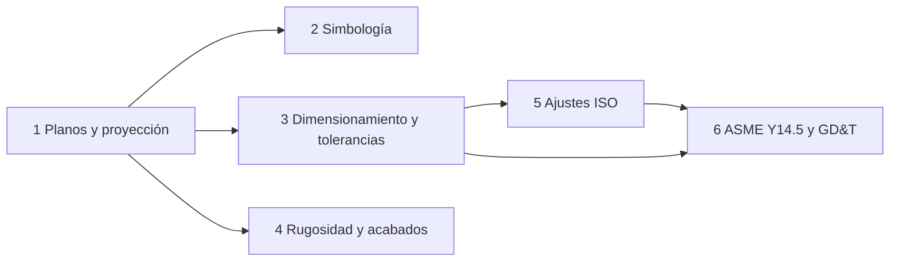

## Estructura

| Sección del sitio | Carpeta en el repositorio | Qué contiene |
|---|---|---|
| Guía de uso | `src/content/docs/guia/` | Cómo estudiar, usar ejercicios y modelos, contribuir, citar y vigencia |
| Módulos 1–6 | `src/content/docs/modulo-NN-slug/` | Temas, ejercicios con solución y referencias |
| Laboratorios | `src/content/docs/laboratorios/` y `public/labs/` | Páginas explicativas y los modelos interactivos |
| Referencia | `src/content/docs/referencia/` | Índice de normas, equivalencias, glosario, bibliografía |

Cada módulo tiene siempre: **Presentación**, **temas numerados**, **Ejercicios** y **Referencias**.

## Orden recomendado

| Semana | Contenido | Entregable de práctica |
|---|---|---|
| 1–2 | Módulo 1 | Reconstruir una pieza a partir de tres vistas |
| 3 | Módulo 2 | Leer un P&ID y un diagrama de escalera |
| 4–5 | Módulo 3 | Revisar un plano real y proponer su esquema de acotación |
| 6 | Módulo 4 | Especificar acabados de una pieza con justificación |
| 7–8 | Módulo 5 | Seleccionar y calcular tres ajustes preferentes |
| 9–10 | Módulo 6 | Definir referencias y marcos de una brida |

## Rutas rápidas

- **Necesito leer un plano hoy:** [1.1](../../modulo-01-interpretacion-de-planos/01-introduccion/) → [1.5](../../modulo-01-interpretacion-de-planos/05-vistas-y-secciones/) → [3.3](../../modulo-03-dimensionamiento-y-tolerancias/03-acotaciones/).
- **Voy a especificar ajustes:** [5.1](../../modulo-05-ajustes-iso/01-simbologia-y-ajustes/) → [calculadora](../../laboratorios/calculadora-iso286/) → [5.4](../../modulo-05-ajustes-iso/04-calculo-de-ajustes/).
- **Voy a certificarme en GD&T:** módulos 3 y 5 → [Módulo 6](../../modulo-06-asme-y14-5-gdt/).

:::tip[Buscar]
Use el buscador del sitio (Ctrl/Cmd + K): indexa todos los módulos y el glosario.
:::
