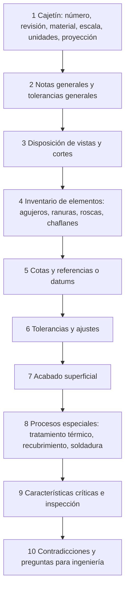

## El plano como lenguaje técnico

Un plano (dibujo técnico) comunica **forma, tamaño, tolerancias, material y requisitos de proceso** de una pieza o conjunto sin ambigüedad. Es además un documento contractual: lo que está en el plano es lo que se compra, se fabrica y se inspecciona.

Para ingeniería industrial el plano es entrada de casi todo lo demás: la **hoja de ruta** de manufactura, el diseño de herramentales y dispositivos, el estudio de tiempos, el **plan de control** de calidad, el costeo y la distribución en planta.

## Tipos de planos

| Tipo | Contenido | Quién lo usa |
|---|---|---|
| De detalle (pieza) | Una pieza con todas sus cotas y tolerancias | Manufactura, inspección |
| De conjunto (ensamble) | Piezas ensambladas, globos y lista de materiales (BOM) | Ensamble, compras |
| De despiece / explosionado | Piezas separadas a lo largo de ejes de montaje | Mantenimiento, ensamble |
| Esquemático / diagrama | Símbolos y conexiones (eléctrico, neumático, P&ID) | Mantenimiento, instalación |
| Isométrico de tubería | Trazado 3D de líneas con cotas y lista de materiales | Montaje de tubería |
| Distribución en planta (layout) | Ubicación de máquinas, flujos, servicios y seguridad | Ingeniería industrial |
| Diagrama de flujo de proceso | Secuencia de operaciones y transportes | Planeación de producción |

## Ciclo de vida y control de cambios

Todo plano tiene **número de parte, revisión y fecha**. Los cambios se tramitan con una orden o aviso de cambio de ingeniería (ECO/ECN) y la tabla de revisiones debe reflejar qué cambió. Fabricar con una revisión obsoleta es una de las causas más caras de retrabajo.

## Dibujo 2D y definición basada en modelo (MBD)

El plano 2D convive con el **modelo 3D anotado** (PMI): cotas, tolerancias y GD&T se asocian directamente al modelo. Las prácticas de definición digital del producto están en ASME Y14.41 e ISO 16792 (⚠️ ediciones por verificar). Aun con MBD, la lectura sigue las mismas reglas: datos de identificación, requisitos generales, geometría, tolerancias y proceso.

## Método de lectura en diez pasos

:::tip[Regla de oro]
**No tome medidas sobre el plano** (en ASME suele figurar “no escalar el dibujo”). Si falta una cota, se pregunta; no se mide.
:::

## Errores frecuentes

- Leer la forma sin revisar unidades ni sistema de proyección.
- Ignorar las **notas generales**: ahí suelen estar la tolerancia general, el material y los tratamientos.
- Mezclar revisiones de plano y de modelo.
