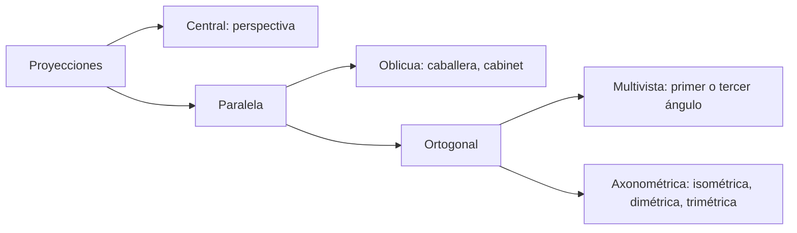
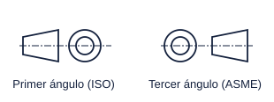

import Lab from '../../../components/Lab.astro';

## Clasificación

Para fabricar se usa casi siempre la **proyección ortogonal multivista**; la axonométrica se emplea para ilustrar y para isométricos de tubería.

## Caja de vidrio y las seis vistas

Imagine la pieza dentro de una caja transparente. Proyectando perpendicularmente sobre sus seis caras y “abriendo” la caja se obtienen: **frontal, superior, inferior, lateral izquierda, lateral derecha y posterior**. La vista frontal es la que mejor describe la pieza y su posición natural de uso.

## Primer y tercer ángulo

| Aspecto | Primer ángulo (ISO, Europa) | Tercer ángulo (ASME, EE. UU./Canadá) |
|---|---|---|
| Posición de la pieza | Entre el observador y el plano de proyección | El plano de proyección queda entre observador y pieza |
| Vista superior | **Debajo** de la frontal | **Encima** de la frontal |
| Vista lateral derecha | A la **izquierda** de la frontal | A la **derecha** de la frontal |
| Cara cercana en las vistas laterales | Queda **lejos** de la vista frontal | Queda **cerca** de la vista frontal |
| Símbolo en el cajetín | Tronco de cono: vista frontal a la izquierda, círculos a la derecha | Círculos a la izquierda, tronco a la derecha |

:::caution[Verificación del símbolo]
La orientación exacta y las proporciones del símbolo están en ISO 5456-2 / ISO 128-3 y ASME Y14.3 (⚠️ no verificadas hoy). Lo importante: **el plano debe indicar el método** y el lector debe comprobarlo antes de interpretar.
:::

Pruebe la diferencia en el laboratorio:

<Lab id="vistas-ortogonales" alto={760} titulo="Vistas ortogonales: primer y tercer ángulo" />

## Reglas de alineación y precedencia de líneas

- Las vistas **se alinean**: las cotas horizontales se transfieren entre frontal y superior; las verticales entre frontal y lateral.
- Cuando dos líneas coinciden, se dibuja la de mayor precedencia: **visible > oculta > plano de corte > eje > cota/proyección**.
- Elija como vista frontal la más descriptiva, con menos líneas ocultas, y con la pieza en su posición funcional (un eje se dibuja horizontal).

## Proyecciones axonométricas y oblicuas

| Proyección | Ejes | Escala | Uso |
|---|---|---|---|
| Isométrica (verdadera) | Tres ejes a 120°; horizontales a 30° | Acortamiento √(2/3) ≈ **0.816** en los tres ejes | Ilustraciones, isométricos de tubería |
| Dibujo isométrico | Igual | Se miden longitudes reales (factor 1); resulta ≈ 1.225 veces mayor | Croquis |
| Dimétrica / trimétrica | Dos o tres escalas distintas | Variable | Ilustración técnica |
| Oblicua caballera | Frente en verdadera magnitud; profundidad a 45° | Profundidad 1:1 | Croquis rápidos |
| Oblicua cabinet | Igual | Profundidad 1:2 | Croquis menos deformados |

El factor 0.816 sale de que los tres ejes forman el mismo ángulo con el plano de proyección: cada longitud se proyecta con coseno² = 2/3.

## Ejemplo resuelto

Un cubo de 60 mm de arista en proyección isométrica verdadera: cada arista se ve de 60 × 0.816 = **49 mm**. En el dibujo isométrico práctico se trazan 60 mm.
