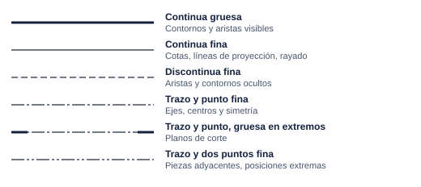

## Quién normaliza

| Ámbito | Organismo / comité | Normas representativas |
|---|---|---|
| Internacional | ISO/TC 10 (documentación técnica de producto) · ISO/TC 213 (especificaciones geométricas, GPS) | ISO 128, ISO 129-1, ISO 5456, ISO 1101 |
| Estados Unidos | ASME, comité Y14 | ASME Y14.1, Y14.2, Y14.3, Y14.5, Y14.100 |
| Electrotecnia | IEC | IEC 60617 (símbolos gráficos) |
| México | DGN / NMX, STPS (NOM) | Para seguridad: NOM-026-STPS-2008 (ver [Módulo 2](../../modulo-02-simbologia-en-planos/04-planos-de-seguridad/)) |

:::note[México]
No se identificó en esta verificación una NMX específica de dibujo técnico: consulte el Catálogo Mexicano de Normas (DGN) antes de citar una. ⚠️
:::

## Tipos de línea

- **Series de grosor ISO 128-2:2022:** 0.13, 0.18, 0.25, 0.35, 0.5, 0.7, 1, 1.4 y 2 mm (razón √2). Se usan **dos grosores con relación 1:2**; pares frecuentes: 0.25/0.5, 0.35/0.7 y 0.5/1 mm. 🟡
- **ASME Y14.2** también define dos grosores (grueso y delgado) y su propio catálogo de líneas (visible, oculta, centro, plano de corte, rotura, fantasma). Los valores mínimos de grosor deben tomarse de la edición vigente. ⚠️

## Rotulado

Letra **de trazo uniforme, legible y reproducible** (microfilm, escaneo). ISO 3098 define alturas en serie √2 (… 2.5, 3.5, 5, 7, 10 mm …); ASME Y14.2 recomienda letra mayúscula de un trazo. ⚠️ Las alturas mínimas dependen de la edición y del tamaño de hoja.

## Cajetín (bloque de títulos)

Campos habituales (ISO 7200 / ASME Y14.100): propietario o empresa, **número de parte**, título, **material**, **escala**, **unidades**, **método de proyección**, **tolerancias generales**, **revisión**, fechas y firmas, hoja n de N. ⚠️ (ediciones por verificar).

## Escalas

Escala = tamaño dibujado ÷ tamaño real. Escalas normalizadas (ISO 5455, ⚠️ edición por verificar): **reducción** 1:2, 1:5, 1:10, 1:20, 1:50, 1:100…; **ampliación** 2:1, 5:1, 10:1, 20:1, 50:1; **natural** 1:1. Las cotas siempre indican el tamaño **real**, no el dibujado.

## Unidades y notación

- Predeterminado en dibujos métricos: **milímetros**, indicados en una nota o en el cajetín. En ASME debe declararse si las cotas están en mm o in.
- En este material se usa **punto decimal**, como en la práctica mexicana y en ASME.
- ASME Y14.5: en pulgadas se omite el cero inicial (.500) y se usan los mismos decimales que la tolerancia; en milímetros se escribe el cero inicial (0.5). ⚠️ (verificar redacción en §4 de Y14.5-2018).
