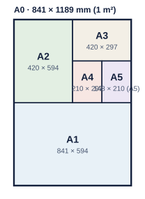

## Serie ISO A (ISO 216 / ISO 5457)

Relación de lados 1 : √2 y **área de A0 = 1 m²**; cada formato se obtiene doblando el anterior por la mitad del lado largo.

| Formato | mm | in (aprox.) | Área |
|---|---|---|---|
| A0 | 841 × 1189 | 33.11 × 46.81 | 1 m² |
| A1 | 594 × 841 | 23.39 × 33.11 | 0.5 m² |
| A2 | 420 × 594 | 16.54 × 23.39 | 0.25 m² |
| A3 | 297 × 420 | 11.69 × 16.54 | 0.125 m² |
| A4 | 210 × 297 | 8.27 × 11.69 | 0.0625 m² |

## Formatos ASME (Y14.1-2020, pulgadas decimales)

| Designación | in | mm |
|---|---|---|
| A | 8.50 × 11.00 | 215.9 × 279.4 |
| B | 11.00 × 17.00 | 279.4 × 431.8 |
| C | 17.00 × 22.00 | 431.8 × 558.8 |
| D | 22.00 × 34.00 | 558.8 × 863.6 |
| E | 34.00 × 44.00 | 863.6 × 1117.6 |
| F | 28.00 × 40.00 | 711.2 × 1016.0 |

:::caution[Verificación]
La edición ASME Y14.1-2020 se localizó en catálogo; las dimensiones se tomaron de práctica ampliamente publicada y **deben confirmarse** en la norma (⚠️). ASME Y14.1M (métrica) usa los formatos A0–A4 de ISO.
:::

## Márgenes, marco y plegado

- El dibujo se encierra en un **marco** de trazo grueso. Los márgenes usuales son 20 mm del lado de archivo (izquierdo) y 10 mm en los demás lados; en A0 y A1 suelen ser mayores. ⚠️ (valores exactos en ISO 5457).
- El cajetín va en la **esquina inferior derecha**.
- Para archivo, los planos grandes se pliegan a tamaño A4 dejando visible el cajetín.
- Marcas de centrado, de recorte y referencias de zona (letras y números en el marco) ayudan a localizar detalles.

## Cómo elegir hoja y escala

1. Calcule el espacio de las vistas: ancho = frente + separación + lateral; alto = frente + separación + superior.
2. Añada espacio para cotas (≈ 20–30 mm por lado), márgenes y cajetín.
3. Pruebe la **escala normalizada más grande** que quepa; use la hoja más pequeña que funcione.

**Ejemplo.** Pieza de 900 × 600 × 300 mm a escala 1:5 → frente 180 × 120 mm, superior 180 × 60, lateral 60 × 120. Con 30 mm de separación: ancho 180 + 30 + 60 = 270 mm; alto 120 + 30 + 60 = 210 mm. Sumando márgenes y cotas no cabe en A4 horizontal (297 × 210); **cabe en A3 (420 × 297)**.
