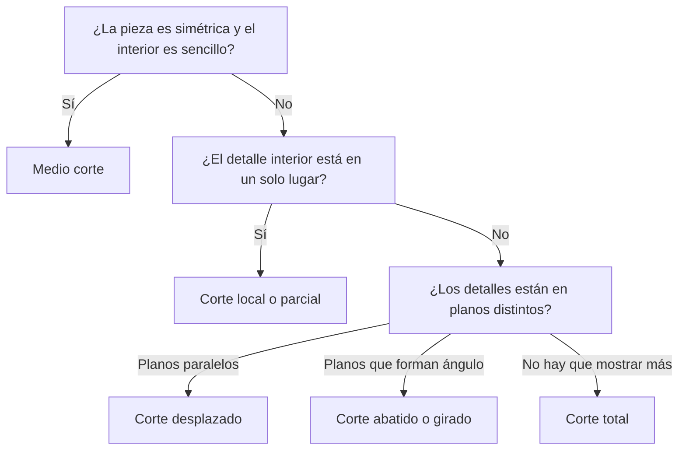

## Tipos de vista

| Vista | Para qué sirve |
|---|---|
| Principales (frontal, superior, laterales) | Describir la forma general |
| Auxiliar | Mostrar en verdadera magnitud una cara inclinada |
| Parcial / local | Mostrar sólo un elemento y ahorrar espacio |
| De detalle (ampliada) | Aclarar un elemento pequeño en escala mayor |
| Interrumpida | Piezas largas de sección constante (ejes, perfiles) |
| Simétrica (media vista) | Piezas simétricas: se dibuja una mitad con marcas de simetría |

## Cortes y secciones

El **plano de corte** se indica con línea de trazo y punto (gruesa en extremos y cambios de dirección), flechas que señalan el sentido de observación y letras (A–A). La parte cortada se **raya** con líneas finas, normalmente a 45°, igualmente espaciadas.

| Tipo | Idea |
|---|---|
| Total | El plano atraviesa toda la pieza |
| Medio corte | Una mitad en corte y otra en vista, en piezas simétricas |
| Desplazado | El plano cambia de nivel para captar varios detalles |
| Abatido | Se gira un detalle inclinado hasta el plano de corte |
| Sección abatida sobre la vista / sección desplazada | La forma del perfil se muestra sobre la vista o a un lado |
| Local (parcial) | Se rompe una zona para mostrar un detalle |

## Qué no se corta (corte longitudinal)

Nervios o costillas, ejes macizos, pernos, tornillos, tuercas, pasadores, chavetas, remaches y rayos **no se rayan** cuando el plano pasa por su eje o su plano longitudinal; así no se confunde su forma con la de un cuerpo macizo. (ISO 128-3, ASME Y14.3.)

## Convenciones útiles

- **Conjuntos:** piezas contiguas se rayan con dirección o espaciado distintos; una misma pieza lleva siempre el mismo rayado en todas sus secciones.
- **Piezas delgadas** (láminas, perfiles estrechos): pueden rellenarse en negro.
- **Roscas:** representación simplificada según ISO 6410 (⚠️ edición por verificar) y ASME Y14.6.
- **Elementos repetidos:** se dibuja uno y se indica la cantidad (4×).
- **Intersecciones y chaflanes pequeños** pueden representarse de forma simplificada para no saturar.

## Errores frecuentes

- Rayar una costilla cortada longitudinalmente.
- Olvidar el sentido de las flechas del corte.
- Mezclar cotas de elementos ocultos con líneas discontinuas: **cote sobre vistas visibles o cortes**.
