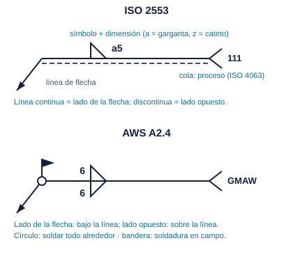

## Símbolo de soldadura

| Elemento | ISO 2553 | AWS A2.4 |
|---|---|---|
| Línea de flecha | Une el símbolo con la junta | Igual |
| Línea de referencia | **Continua**, más una **línea de identificación discontinua** | Una sola línea de referencia |
| Lado de la flecha | Símbolo sobre la línea continua | Símbolo **bajo** la línea de referencia |
| Lado opuesto | Símbolo sobre la línea discontinua | Símbolo **sobre** la línea de referencia |
| Dimensión de filete | **a** = altura de garganta; **z** = lado (cateto) | Lado (cateto) a la **izquierda** del símbolo |
| Cola | Proceso (ISO 4063) y datos | Proceso y especificaciones |
| Todo alrededor / en campo | Círculo en la unión de flecha y línea; bandera | Igual |

Símbolos elementales frecuentes: tope sin bisel (I), V, medio V (bisel), U, J, **filete** (triángulo con el lado vertical a la izquierda), tapón/ranura, punto y costura.

:::caution[Verificación]
ISO 2553 y AWS A2.4: **ediciones no verificadas hoy** (⚠️). La tabla refleja la estructura conocida de ambos sistemas; confirme detalles de posición y dimensiones en la edición vigente.
:::

**Equivalencia útil para filetes de lados iguales:** a ≈ 0.707 · z. Un filete z7 corresponde a a ≈ 4.9 mm, es decir, **a5 ≈ z7**.

## Procesos (ISO 4063) y siglas AWS

| Número ISO 4063 | Proceso | Sigla AWS |
|---|---|---|
| 111 | Arco con electrodo revestido | SMAW |
| 121 | Arco sumergido, un alambre | SAW |
| 135 | MAG (gas activo) | GMAW |
| 136 | MAG con alambre tubular | FCAW |
| 141 | TIG (tungsteno, gas inerte) | GTAW |
| 311 | Oxiacetilénico | OAW |

## Tubería: DN, NPS y cédula

DN es la designación métrica nominal; NPS, la de pulgadas. El **diámetro exterior es fijo** para cada tamaño y el espesor cambia con la cédula (schedule).

| NPS | DN | OD (mm) | Espesor SCH 40 (mm) | Espesor SCH 80 (mm) |
|---|---|---|---|---|
| ½ | 15 | 21.3 | 2.77 | 3.73 |
| ¾ | 20 | 26.7 | 2.87 | 3.91 |
| 1 | 25 | 33.4 | 3.38 | 4.55 |
| 1¼ | 32 | 42.2 | 3.56 | 4.85 |
| 1½ | 40 | 48.3 | 3.68 | 5.08 |
| 2 | 50 | 60.3 | 3.91 | 5.54 |
| 3 | 80 | 88.9 | 5.49 | 7.62 |
| 4 | 100 | 114.3 | 6.02 | 8.56 |

Diámetro interior = OD − 2 × espesor. Ejemplo: NPS 2 SCH 40 → 60.3 − 2(3.91) = **52.5 mm**.

:::caution[Verificación]
Valores de ASME B36.10M/B36.19M tomados de tablas de uso común (🟡): **confirme en la norma** antes de especificar o comprar.
:::

## Diagramas P&ID e instrumentación

Un P&ID muestra equipos, líneas, válvulas e instrumentos. Las burbujas de instrumento siguen ISA-5.1: la **primera letra** es la variable medida y las siguientes indican función.

| Letra | Primera posición (variable) | Siguientes (función) |
|---|---|---|
| F | Flujo | |
| T | Temperatura | T = transmisor |
| P | Presión | I = indicador |
| L | Nivel | C = controlador |
| A | | A = alarma |
| V | | V = válvula |
| S | | S = interruptor |

Ejemplos: **FIC-101** controlador indicador de flujo, lazo 101 · **TT-205** transmisor de temperatura · **LAH-301** alarma de nivel alto · **FV-102** válvula de control de flujo. ⚠️ (edición vigente de ANSI/ISA-5.1 por verificar).

## Isométrico de tubería

Dibuja la línea en proyección isométrica con cotas, orientación (flecha norte), números de soldadura (taller o campo) y **lista de materiales**. Se lee siguiendo el flujo desde el equipo de origen.
