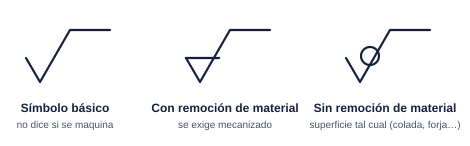

## Componentes de la textura superficial

Una superficie real combina escalas de irregularidad:

| Componente | Descripción | Origen típico |
|---|---|---|
| **Forma** | Desviación macroscópica respecto de la geometría ideal | Defectos de máquina, deformación |
| **Ondulación (waviness)** | Irregularidades más espaciadas que la rugosidad | Vibración, flexión, chatter |
| **Rugosidad** | Irregularidades finas y poco espaciadas | Acción de la herramienta o del proceso |
| **Orientación (lay)** | Dirección predominante del patrón | Método de producción |

Los términos anteriores siguen las definiciones de ASME B46.1-2019. La separación entre componentes se logra con **filtros** (longitud de onda de corte λc).

## Parámetros de perfil (µm)

| Parámetro | Significado | Lectura práctica |
|---|---|---|
| **Ra** | Media aritmética de las desviaciones del perfil respecto de la línea media | El más usado; poco sensible a picos aislados |
| **Rq (RMS)** | Raíz cuadrática media | Más sensible a picos y valles |
| **Rp / Rv** | Altura del pico más alto / profundidad del valle más profundo | Efecto en desgaste y retención de lubricante |
| **Rz** | Altura máxima del perfil: Rp + Rv en la longitud de muestreo | Detecta defectos aislados |
| **Rsm** | Espaciamiento medio de los elementos del perfil | Capacidad de sellado, pintura |
| **Rsk** | Asimetría de la distribución de alturas | Negativa: valles profundos (buena retención de aceite) |

:::caution[Cuidado con Rz]
“Rz” **no significa lo mismo** en todas las normas y ediciones históricas (valor de una longitud de muestreo, promedio de cinco, altura de diez puntos). Antes de interpretar o medir, confirme qué norma y edición cita el plano. ⚠️ (diferencias exactas entre ISO 4287 e ISO 21920-2 por verificar en la norma).
:::

## Longitud de muestreo y de evaluación

La longitud de onda de corte **λc** define la longitud de muestreo; la **longitud de evaluación** es normalmente **5 × λc**. Clases de ajuste (valores heredados de ISO 4288 y recogidos en ISO 21920-3):

| Ra esperada (µm) | λc (mm) | Longitud de evaluación (mm) |
|---|---|---|
| ≤ 0.02 | 0.08 | 0.4 |
| >0.02 – 0.1 | 0.25 | 1.25 |
| >0.1 – 2 | 0.8 | 4 |
| >2 – 10 | 2.5 | 12.5 |
| >10 – 80 | 8 | 40 |

(🟡 tabla de uso común; confirme en ISO 21920-3 los valores y S-filtros asociados.)

## Orientación de las estrías (lay)

| Símbolo | Significado |
|---|---|
| = | Paralelas al plano de proyección de la vista |
| ⊥ | Perpendiculares |
| X | Cruzadas en dos direcciones |
| M | Multidireccional |
| C | Aproximadamente circulares respecto al centro |
| R | Aproximadamente radiales |
| P | No direccional, particulada o protuberante |

## Símbolo gráfico

- **Símbolo básico:** sólo indica que hay requisito de textura.
- **Con remoción de material:** la superficie debe maquinarse.
- **Sin remoción de material:** la superficie se deja como viene del proceso (colada, forja, laminado).

Junto al símbolo se escribe el requisito: **parámetro, valor y, si aplica, regla de aceptación, longitud de muestreo, proceso y orientación**. La **disposición exacta** de los campos cambió entre ISO 1302:2002, ISO 21920-1:2021 y ASME Y14.36: use el ejemplo de la norma que cite el plano. ⚠️

## Reglas de aceptación

- **Regla del 16 %** (ISO 1302:2002, por defecto): se acepta si no más del 16 % de las mediciones supera el límite superior.
- **Regla del máximo** (ISO 21920-1:2021, por defecto): **ningún** valor medido puede exceder el límite.

Un mismo número en el plano (por ejemplo “Ra 1.6”) puede inspeccionarse con criterio distinto según la norma que se cite: otra razón para **declarar la norma y su edición**.
