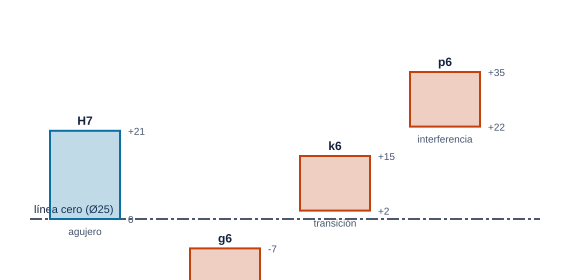
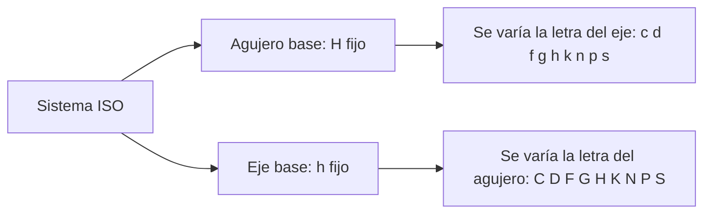

## Cómo se designa una tolerancia

Una **clase de tolerancia** combina una **letra** (posición de la zona respecto de la línea cero: desviación fundamental) y un **número** (grado de tolerancia IT: anchura de la zona).

| Parte | Ejemplo | Significado |
|---|---|---|
| Letra mayúscula | **H**7 | Agujero; H tiene desviación inferior EI = 0 |
| Letra minúscula | **g**6 | Eje; h tiene desviación superior es = 0 |
| Número | H**7** | Grado IT7: ancho de la zona, depende del tamaño |
| Ajuste | Ø25 H7/g6 | Agujero H7 con eje g6, tamaño nominal 25 mm |

## Grados de tolerancia normalizados IT

Hay 20 grados (IT01, IT0, IT1 … IT18). El ancho de la zona crece con el grado y con el tamaño nominal. Para IT5–IT18 se calcula con la unidad de tolerancia **i = 0.45·∛D + 0.001·D** (µm, D = media geométrica del intervalo de tamaños en mm) multiplicada por un factor del grado (IT7 = 16 i, IT8 = 25 i, IT9 = 40 i, IT11 = 100 i…), con el redondeo que fijan las tablas. La [tabla completa](../05-tablas-de-referencia/) se genera de los mismos datos que la calculadora.

## Sistemas de ajuste

- **Agujero base (H):** el agujero tiene EI = 0 y se varía el eje. Es el más usado porque los agujeros se hacen con herramientas de tamaño fijo (brocas, escariadores) y los ejes se ajustan más fácil.
- **Eje base (h):** el eje tiene es = 0. Conviene cuando un mismo eje trefilado o rectificado recibe varias piezas con ajustes distintos.

## Tipos de ajuste

| Tipo | Condición | Montaje típico |
|---|---|---|
| **Con holgura** | Holgura mínima ≥ 0: el eje siempre cabe | Manual, deslizamiento |
| **De transición** | Puede resultar holgura o apriete | Maza ligera o prensa pequeña |
| **Con interferencia (apriete)** | Apriete siempre presente | Prensa o calentamiento/enfriamiento |

Holgura mínima = EI(agujero) − es(eje). Holgura máxima = ES(agujero) − ei(eje). La **tolerancia del ajuste** es la suma de las tolerancias de agujero y eje.

## Ajustes preferentes (ISO 286 / ANSI B4.2)

| Agujero base | Eje base | Carácter | Aplicación típica |
|---|---|---|---|
| H11/c11 | C11/h11 | Holgura grande | Piezas sueltas, tolerancias comerciales |
| H9/d9 | D9/h9 | Giro libre | Poca precisión, grandes variaciones de temperatura |
| H8/f7 | F8/h7 | Giro cercano | Cojinetes de precisión moderada |
| H7/g6 | G7/h6 | Deslizante | Guiado preciso, sin juego apreciable |
| H7/h6 | H7/h6 | Ubicación con holgura | Piezas que se montan y desmontan |
| H7/k6 | K7/h6 | Ubicación de transición | Posicionamiento preciso con maza ligera |
| H7/n6 | N7/h6 | Ubicación de transición firme | Montaje con prensa |
| H7/p6 | P7/h6 | Apriete ligero | Ubicación sin deslizamiento |
| H7/s6 | S7/h6 | Apriete medio | Ajuste permanente |
| H7/u6 | U7/h6 | Apriete fuerte | Montaje térmico o con gran prensa |

🟡 Conjunto de ajustes preferentes ampliamente publicado; verifique la lista y las descripciones en ISO 286 / ASME B4.2. Los ejemplos de aplicación son orientativos.

## Sistema inglés (ASME B4.1)

En pulgadas, ASME B4.1 agrupa los ajustes en **clases** con tolerancias en milésimas de pulgada sobre el sistema de agujero base:

| Clase | Significado |
|---|---|
| RC 1–9 | Giro y deslizamiento (*running and sliding*) |
| LC 1–11 | Ubicación con holgura |
| LT 1–6 | Ubicación de transición |
| LN 1–3 | Ubicación con interferencia |
| FN 1–5 | Fuerza y contracción (*force and shrink*) |

⚠️ No se verificó hoy la vigencia de ASME B4.1 / B4.2 ni sus tablas; **no existe una equivalencia exacta** entre clases RC/LC/LT/LN/FN y las clases ISO: use las tablas de cada sistema.
