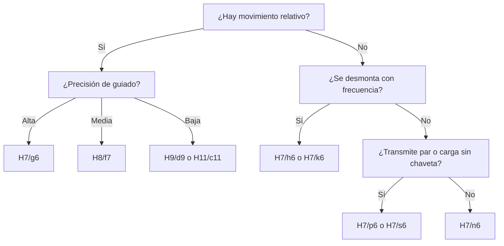

import Lab from '../../../components/Lab.astro';

## Procedimiento

1. Obtenga ES, EI (agujero) y es, ei (eje) de las tablas o de la calculadora.
2. **Holgura mínima** = EI − es. **Holgura máxima** = ES − ei.
3. Si la holgura mínima ≥ 0 → con holgura. Si la máxima ≤ 0 → con interferencia. En otro caso → de transición.
4. **Apriete máximo** = −(holgura mínima) cuando es negativa.

## Ajustes preferentes en Ø25 (µm)

| Ajuste | Agujero (µm) | Eje (µm) | Holgura mín. | Holgura máx. | Tipo |
|:---|---:|---:|---:|---:|:---|
| **H11/c11** | +130 / 0 | −110 / −240 | +110 | +370 | con holgura |
| **H9/d9** | +52 / 0 | −65 / −117 | +65 | +169 | con holgura |
| **H8/f7** | +33 / 0 | −20 / −41 | +20 | +74 | con holgura |
| **H7/g6** | +21 / 0 | −7 / −20 | +7 | +41 | con holgura |
| **H7/h6** | +21 / 0 | 0 / −13 | 0 | +34 | con holgura |
| **H7/k6** | +21 / 0 | +15 / +2 | −15 | +19 | de transición |
| **H7/n6** | +21 / 0 | +28 / +15 | −28 | +6 | de transición |
| **H7/p6** | +21 / 0 | +35 / +22 | −35 | −1 | con interferencia |
| **H7/s6** | +21 / 0 | +48 / +35 | −48 | −14 | con interferencia |

## Ajustes preferentes en Ø50 (µm)

| Ajuste | Agujero (µm) | Eje (µm) | Holgura mín. | Holgura máx. | Tipo |
|:---|---:|---:|---:|---:|:---|
| **H11/c11** | +160 / 0 | −130 / −290 | +130 | +450 | con holgura |
| **H9/d9** | +62 / 0 | −80 / −142 | +80 | +204 | con holgura |
| **H8/f7** | +39 / 0 | −25 / −50 | +25 | +89 | con holgura |
| **H7/g6** | +25 / 0 | −9 / −25 | +9 | +50 | con holgura |
| **H7/h6** | +25 / 0 | 0 / −16 | 0 | +41 | con holgura |
| **H7/k6** | +25 / 0 | +18 / +2 | −18 | +23 | de transición |
| **H7/n6** | +25 / 0 | +33 / +17 | −33 | +8 | de transición |
| **H7/p6** | +25 / 0 | +42 / +26 | −42 | −1 | con interferencia |
| **H7/s6** | +25 / 0 | +59 / +43 | −59 | −18 | con interferencia |

Observe cómo H7/p6 en Ø50 deja sólo 1 µm de apriete mínimo: **“interferencia” no significa mucha fuerza**, sino que nunca hay holgura.

## Calculadora

<Lab id="calculadora-iso286" alto={720} titulo="Calculadora de ajustes ISO 286" />

## Montaje por interferencia térmica

Para ensamblar un ajuste con apriete se puede calentar la pieza con agujero (o enfriar el eje). El cambio de diámetro es **Δd = α · d · ΔT**. Para acero, α ≈ 11.5 × 10⁻⁶ /K (valor típico).

**Ejemplo.** H7/p6 en Ø25: apriete máximo 35 µm. Se desea una holgura de montaje de 20 µm → expansión requerida Δd = 35 + 20 = 55 µm. Por kelvin el diámetro cambia 11.5 × 10⁻⁶ × 25 mm = 0.2875 µm/K → ΔT = 55 / 0.2875 ≈ **191 K**; es decir, calentar el cubo de unos 20 °C a ≈ 211 °C. Revise que esa temperatura no altere el tratamiento térmico del material.

## Cómo elegir

Otras consideraciones: temperatura de trabajo, diferencia de materiales, rugosidad (afecta el apriete efectivo por el aplanamiento de crestas), costo de inspección (calibres pasa/no pasa) y los fabricantes de componentes: los de **rodamientos** publican las clases recomendadas de eje y alojamiento según carga y giro.
