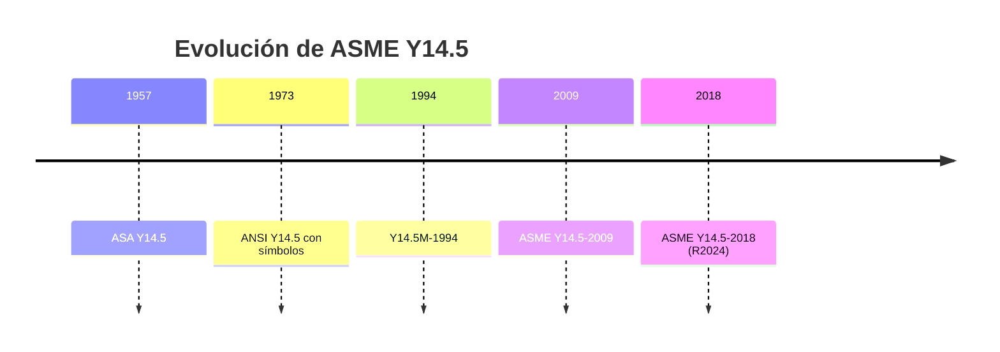

## ¿Qué es ASME Y14.5?

**ASME Y14.5, «Dimensioning and Tolerancing»**, es la norma estadounidense que define cómo acotar y tolerar un producto, incluida la **tolerancia geométrica (GD&T)**: símbolos, reglas fundamentales, referencias, modificadores y definiciones. Pertenece a la serie Y14 («Engineering Product Definition and Related Documentation Practices») del comité de ASME.

## Línea de tiempo de ediciones

| Año | Edición | Observación |
|---|---|---|
| 1957 | ASA Y14.5 | Primera versión (🟡) |
| 1966 | USASI Y14.5 | (🟡) |
| 1973 | ANSI Y14.5 | Adopta símbolos gráficos para GD&T (🟡) |
| 1982 | ANSI Y14.5M-1982 | |
| 1994 | ASME Y14.5M-1994 | RFS pasa a ser el valor por defecto (🟡) |
| 2009 | ASME Y14.5-2009 | Se eliminan los símbolos de concentricidad y simetría |
| **2018** | **ASME Y14.5-2018 (R2024)** | **Edición vigente**; reafirmada en 2024 (✅) |

La edición de 2018 reorganizó el contenido y añadió, entre otras novedades, el modificador de **perfil dinámico** (🟡). ASME ofrece certificaciones de profesional de GD&T (GDTP) basadas en Y14.5-2018.

## Relación con ISO

ISO trata la tolerancia dentro del modelo **GPS (Especificaciones Geométricas de Producto)**: ISO 1101 (tolerancia geométrica), ISO 5459 (referencias), ISO 2692 (requisitos de material), ISO 8015 (principio fundamental de tolerancia) e ISO 14405 (tamaños). Ambas familias comparten la lógica general pero **difieren en reglas por defecto** (ver [comparación](../04-asme-frente-a-iso/)).

:::caution[Importante]
Un plano debe **citar la norma y su edición** (p. ej. «ASME Y14.5-2018» o «ISO 1101:2017 / ISO 8015:2011»): de eso depende cómo se interpretan las reglas por defecto.
:::

## Normas relacionadas de ASME

- Y14.100 (prácticas de ingeniería de dibujo) · Y14.41 (definición digital del producto / MBD) · Y14.36 (símbolos de textura superficial) · Y14.3 (vistas) · Y14.2 (líneas y rotulado). ⚠️ Ediciones por verificar en el catálogo de ASME.
