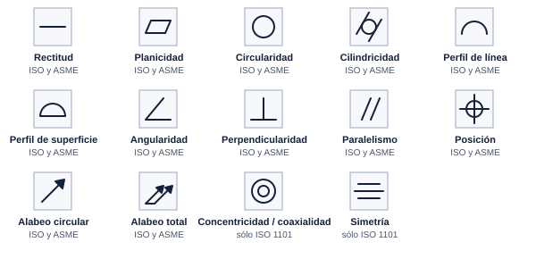
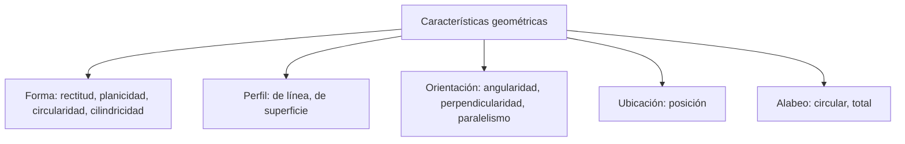
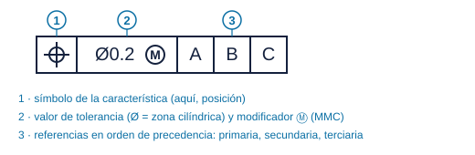

## Idea central

Las tolerancias de tamaño (±) **no controlan** por sí solas forma, orientación ni ubicación con la precisión que exige una función. GD&T define **zonas de tolerancia** geométricas y **referencias** para ubicarlas. Su propósito: especificar la función y permitir la **máxima tolerancia de fabricación** que la cumple.

## Las características geométricas

| Categoría | Necesita referencia | Qué controla |
|---|---|---|
| Forma | No | Forma del elemento por sí solo |
| Perfil | Depende | Forma, orientación y/o ubicación de una superficie |
| Orientación | Sí | Ángulo respecto de una referencia |
| Ubicación | Sí | Posición respecto de referencias |
| Alabeo | Sí (eje) | Variación al girar la pieza |

**ASME Y14.5-2018 define 12 características.** ISO 1101 conserva además **concentricidad/coaxialidad** y **simetría** (14 en total).

## Marco de control de característica

Se lee de izquierda a derecha: **símbolo** → **tolerancia** (el prefijo Ø indica zona cilíndrica; modificadores como Ⓜ) → **referencias** en orden de precedencia. Ejemplo: «Posición, zona cilíndrica de Ø0.2 en MMC respecto de A, B y C».

## Referencias (datums) y grados de libertad

Un **sistema de referencias** (DRF) fija la pieza en el espacio con tres planos mutuamente perpendiculares. Una pieza libre tiene **6 grados de libertad** (3 traslaciones y 3 rotaciones). La regla 3-2-1:

| Referencia | Grados que restringe |
|---|---|
| Primaria | 3 (1 traslación + 2 rotaciones) |
| Secundaria | 2 (1 traslación + 1 rotación) |
| Terciaria | 1 (1 traslación) |

Las referencias se **simulan** en la inspección con superficies de contacto (simuladores) y se ordenan por **precedencia**: primero la superficie funcionalmente más importante y estable.

## Reglas fundamentales (resumen)

1. **Regla n.º 1 (envolvente):** sin otra indicación, un elemento de tamaño regular tiene forma perfecta a **MMC**: no sale de la envolvente de ese tamaño.
2. **RFS por defecto:** las tolerancias geométricas y las referencias aplican sin importar el tamaño real salvo que se indique Ⓜ o Ⓛ. (🟡 desde 1994)
3. Los **límites de tamaño** se verifican en cada sección transversal; la **forma** se verifica sobre el elemento completo.
4. Todas las dimensiones se aplican a **20 °C (68 °F)** salvo nota.

:::caution[Verificación]
Estas reglas están resumidas con fines didácticos (nivel 🟡): **la redacción normativa está en ASME Y14.5-2018 §4–§7** (⚠️ no se tuvo acceso al texto de pago). Los ejemplos de plano de este módulo son originales.
:::

## Ejemplo: de la función al marco

Una brida con cuatro agujeros que reciben tornillos M8 debe acoplar con otra pieza. Función: los agujeros deben coincidir con los de la pieza compañera. Estrategia: **posición de los 4 agujeros respecto de la cara de apoyo (A) y del agujero central (B)**, con Ⓜ para aprovechar el bonus.
